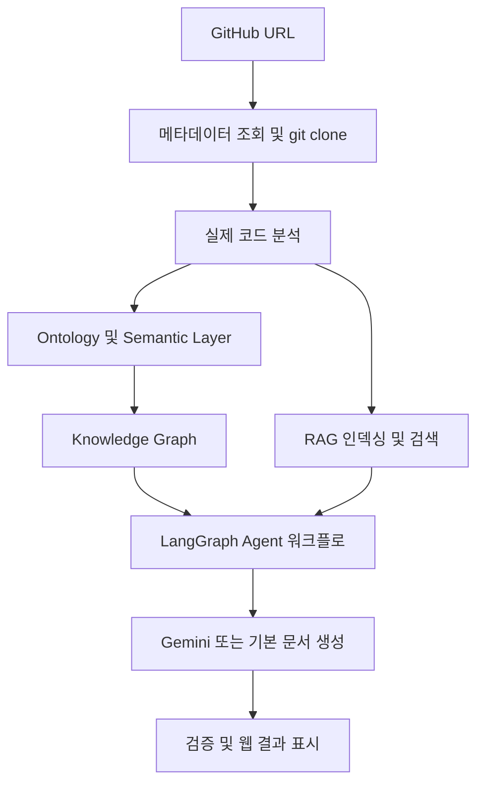

# RepoDoc Agent

공개 GitHub 저장소의 실제 코드를 분석하고, 온톨로지와 지식 그래프 및 RAG 검색 결과를 활용해 기술 문서를 생성하는 웹 애플리케이션입니다.

## 주요 기능

- GitHub URL 입력, 저장소 메타데이터 조회 및 코드 복제
- 디렉터리, 모듈, 클래스, 함수, API 엔드포인트와 의존성 분석
- Ontology를 통한 코드 엔티티 및 관계 정의
- Semantic Layer를 통한 엔티티 분류 및 조회
- NetworkX 기반 Knowledge Graph 구성 및 Neo4j 저장
- Sentence Transformers 임베딩과 코사인 유사도를 사용하는 RAG 검색
- LangGraph 기반 분석 → 아키텍처 → 문서 작성 → 검증 Agent 워크플로
- 분석 결과 확인 및 Markdown 문서 다운로드

## 실행 환경

- Python 3.11 권장
- Node.js 22.12 이상 및 npm 권장
- Git
- Docker 및 Docker Compose: Neo4j를 사용할 때 필요
- GitHub API, 저장소 복제, 임베딩 모델 다운로드 및 Gemini 호출에 필요한 네트워크 연결

대형 생성 모델을 로컬에서 실행하지 않습니다. 문서 생성은 Gemini API를 사용하고, 검색용 임베딩 모델은 로컬에서 실행합니다.

## 빠른 시작

아래 명령은 프로젝트 루트 디렉터리에서 시작합니다.

### 1. 백엔드 의존성 설치

```bash
python3.11 -m venv .venv
source .venv/bin/activate
python -m pip install --upgrade pip
python -m pip install -r backend/requirements.txt
```

Python 의존성은 `backend/requirements.txt`, 프런트엔드 의존성은 `frontend/package.json`에서 관리합니다.

### 2. 환경 변수 설정

`backend/.env` 파일을 만들고 다음 값을 설정하세요. 백엔드는 이 경로를 자동으로 읽습니다.

```dotenv
GEMINI_API_KEY=your_gemini_api_key
GEMINI_MODEL=gemini-2.0-flash-lite
EMBEDDING_MODEL=BAAI/bge-small-en-v1.5
NEO4J_URI=bolt://localhost:7687
NEO4J_USERNAME=neo4j
NEO4J_PASSWORD=repo-doc-agent
```

`GEMINI_MODEL`의 예시는 현재 코드의 기본값입니다. 계정에서 사용할 수 있는 Gemini Flash 계열 모델명으로 변경할 수 있습니다.

API Key는 로컬 `backend/.env`에서만 관리하세요. 프런트엔드 코드나 `VITE_*` 환경 변수에 넣지 마세요. `.env` 파일은 `.gitignore`에 포함되어 있습니다.

키가 없거나 Gemini 호출이 실패하면 코드 분석 결과를 바탕으로 기본 문서를 생성합니다. 실제 AI 문서 생성을 사용하려면 유효한 키와 모델 설정이 필요합니다.

### 3. Neo4j 시작 (선택 사항)

```bash
docker compose up -d neo4j
```

- Neo4j Browser: <http://localhost:7474>
- 기본 사용자 이름: `neo4j`
- 로컬 개발용 비밀번호: `repo-doc-agent`

Neo4j에 연결할 수 없으면 메모리 그래프를 사용합니다. Neo4j 없이 실행하려면 `backend/.env`에 `NEO4J_URI=`를 설정하세요. 비밀번호를 변경할 때는 `docker-compose.yml`의 인증 설정도 맞춰야 합니다.

### 4. 백엔드 시작

가상 환경이 활성화된 프로젝트 루트에서 실행합니다.

```bash
python -m uvicorn app.main:app --app-dir backend --reload --port 8000
```

- 상태 확인: <http://localhost:8000/api/health>
- API 문서: <http://localhost:8000/docs>

### 5. 프런트엔드 시작

새 터미널에서 실행합니다.

```bash
cd frontend
npm install
npm run dev -- --port 5173 --strictPort
```

<http://localhost:5173>에서 공개 저장소 URL을 입력하고 분석을 시작하세요. 프런트엔드는 현재 `http://localhost:8000`으로 요청하며, 백엔드 CORS 설정은 로컬 5173 포트를 허용합니다.

## 처리 흐름



## API

| 메서드 | 경로 | 설명 |
| --- | --- | --- |
| GET | `/api/health` | 서버 상태 및 설정 유무 |
| POST | `/api/analyze` | 저장소 분석 및 문서 생성 |
| GET | `/api/tasks` | 메모리에 보관된 작업 목록 |
| GET | `/api/tasks/{task_id}` | 개별 작업 상태 및 결과 |

```bash
curl -X POST http://localhost:8000/api/analyze \
  -H 'Content-Type: application/json' \
  -d '{"github_url":"https://github.com/pallets/flask"}'
```

분석 응답에는 `task_id`, `status`, `data`가 포함됩니다. `data`에서 코드 분석 결과, 그래프 상태, 검색 근거, Agent 상태, 생성 문서와 검증 결과를 확인할 수 있습니다.

## 검증

프로젝트 루트에서 가상 환경을 활성화한 후 실행합니다.

```bash
python -m pytest backend/tests -q
```

기존 테스트는 임시 Python 저장소의 함수·클래스·API·의존성 추출과 생성 문서의 저장소 사실 반영을 검증합니다. 실제 GitHub 및 Gemini 연동은 서버를 실행하고 공개 저장소로 별도 확인해야 합니다.

프런트엔드 빌드 및 린트:

```bash
cd frontend
npm run build
npm run lint
```

## 프로젝트 구조

```text
.
├── README.md
├── REQUIREMENTS.md          # 기능 요구사항
├── ARCHITECTURE.md          # 아키텍처 문서
├── TASKS.md                 # 단계별 작업 목록
├── docker-compose.yml      # Neo4j 로컬 실행
├── backend/
│   ├── requirements.txt     # Python 의존성
│   ├── app/
│   │   ├── main.py          # FastAPI 엔드포인트
│   │   ├── config.py        # 환경 변수 설정
│   │   ├── core/            # Ontology, Semantic Layer, Knowledge Graph
│   │   └── services/        # GitHub, 코드 분석, RAG, Gemini, Agent
│   └── tests/
└── frontend/                # React + TypeScript + Vite
```

## 현재 제한 및 문제 해결

- 분석 API는 동기 방식으로 전체 작업을 수행합니다. 웹 화면에 실행 상태는 표시되지만 단계별 실시간 이벤트 전송은 구현되어 있지 않습니다.
- 웹 문서 영역은 현재 Markdown 원문을 표시합니다. Markdown 및 Mermaid의 렌더링 미리보기는 아직 구현되어 있지 않습니다.
- RAG 문서는 메모리에 보관되며, 전체 소스 코드 대신 README 요약과 파일·함수·API 메타데이터를 검색합니다. 디렉터리 이름과 달리 Chroma DB는 사용하지 않습니다.
- 최초 분석 시 임베딩 모델 다운로드가 필요할 수 있습니다. 로딩에 실패하면 0 벡터를 사용하므로 의미 기반 검색 품질을 보장할 수 없습니다. 네트워크와 모델 접근 가능 여부를 확인하세요.
- `/api/health`의 설정 플래그는 설정값 존재 여부이며 외부 서비스 연결 성공을 보장하지 않습니다.
- GitHub 조회 오류가 발생하면 URL, 공개 저장소 여부, 네트워크 및 비인증 API 요청 제한을 확인하세요. 현재 GitHub 토큰 인증은 구현되어 있지 않습니다.
- 복제한 저장소는 `backend/.tmp/repos/`에 캐시됩니다. 같은 이름의 폴더가 있으면 재사용하므로 최신 코드가 필요하거나 소유자가 다른 동명 저장소를 분석할 때는 해당 캐시 폴더를 정리하세요.
- 작업 목록과 메모리 그래프 및 RAG 인덱스는 서버 재시작 후 유지되지 않습니다. Docker Compose는 Neo4j만 실행하며 프런트엔드와 백엔드는 별도로 시작해야 합니다.
